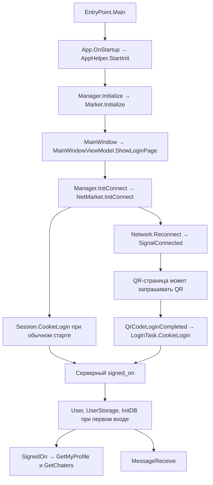

# Жизненный цикл IMO Windows 1.5.9.3

Проверена установленная сборка Pagebites, Inc. Идентичность файлов, сигнатуры, видимость методов и значения enum зафиксированы в [карте сборок](../research/assembly_map/installed.json). Стрелки ниже восстановлены из IL официальных бинарников. Для защищённых сборок IL читался после штатных инициализаторов модулей в отдельном x86 AppContainer. Этот способ показывает вызовы и условия, которые содержатся в коде. Он не даёт временную трассу запуска основного клиента.

## От EXE до списка чатов

| Этап | Классы, методы и зависимости |
| --- | --- |
| 1. Запуск | `Imo.Main.EntryPoint.Main(string[])` вызывает `WaitForRestartParentExit`, затем `SingleInstanceAppWrpper.Run`. Обёртка наследует `Microsoft.VisualBasic.ApplicationServices.WindowsFormsApplicationBase` и включает `IsSingleInstance`. Для нового экземпляра `OnStartup` создаёт WPF `Imo.Main.App`. Второй запуск передаёт аргументы существующему экземпляру и активирует окно. |
| 2. CLR и DLL | PE требует x86, EXE и конфигурация указывают .NET Framework 4.6.1. Из запущенного процесса получены имена нативных модулей CLR и транспорта. Стенд отдельно загрузил управляемые сборки. Порядок загрузки всех DLL в живом экземпляре не измерялся. |
| 3. Основные объекты | `App.OnStartup(StartupEventArgs)` вызывает проверку DLL и `AppHelper.StartInit`. В `StartInit` сначала выполняются настройки приложения и фоновые задачи, затем `Imo.Dispatcher.Manager.Initialize(MainEntry.Instance)`. `Market.Initialize()` создаёт `Market` и его список `BaseTask`. `Manager.Initialize` подписывается на `Market.ReceivedData` и `ReceivedDevData`. `IMO.Instance` создаёт объект `User` при обращении. Объект может существовать до входа. |
| 4. Окно и сеть | После успешного `Manager.Initialize` создаётся `MainWindow`, который обращается к `MainWindowViewModel.Instance`. После создания окна `Manager.InitConnect()` вызывает `Market.InitConnect()`. Последний получает ленивый `NetMarket.Instance`, подписывает обработчики и планирует `NetMarket.InitConnect()`. Конструктор `NetMarket` вызывает `Init()`, где регистрируются сетевые сервисы и события `Connection.Dispatcher` и `Network`. |
| 5. Прежний вход | `ApplicationSettings.InitFromStorage()` загружает признаки сохранённого входа. `NetMarket.InitConnect()` вызывает `Network.Reconnect`, а затем `Session.CookieLogin(string, bool)`, если режим запуска отличается от `ChangeUser`. Порядок этих двух вызовов в IL не означает ожидание завершения соединения перед постановкой login-запроса. |
| 6–8. QR и телефон | `MainWindowViewModel.ShowLoginPage()` ведёт на `SignInWithScanPageView`. При сохранённом входе VM сначала показывает ожидание. В QR-ветви `SignInWithScanPageViewModel` запрашивает QR, рендерит полученную строку и отдельно обрабатывает уведомления о сканировании, завершении и отмене. [Разбор QR](qr_authentication_flow.md) |
| 9. Аккаунт авторизован | Обработка `signed_on` в `AccountMessageManager.HandleMessage(JObject)` обновляет `User`, состояние авторизации и хранилище. При первоначальном входе инициализируется БД. Затем поднимается `ActionTypes.SignedOn` с `SignOnData`. |
| 10. Профиль | `MainEntry.OnAction(SignedOn, result)` вызывает `MainWindowViewModel.HandleSignedOn()`. VM заказывает `GetMyProfile` через `LoginTask.GetMyProfile(ActionParamer)` и сетевой `LoginService.GetMyProfile`, ставит переход на `MainPage` в очередь WPF. Поля `User` сначала заполняются из `signed_on`. У профиля есть отдельный последующий запрос. |
| 11. Чаты | `MessagePlugEntry.OnAction(SignedOn, result)` вызывает `ChatsListViewModel.HandleSignedOn()`. Первый проход запрашивает локальный `GetChaters`; затем запрашивается сетевой `GetChaters`. `ForChatersTask.GetChaters` разводит ветви через `DBMarket` и `NetMarket.Work`. Плагин принимает ответы в `HandleGetChatersLocal` и `HandleGetChatersNet`. После сетевой загрузки `InitNetData` инициирует дополнительную синхронизацию, включая список контактов. |
| 12. Входящие | Сетевой `Dispatcher` передаёт push в `NetMarket`, затем в `Market`. `MessageManager.HandleRecvIm` создаёт модель, `ForMessagesTask` проверяет готовность БД и доставляет `MessageReceive` обработчикам. [Трасса получения](incoming_message_flow.md) |
| 13. Reconnect | `Network` обрабатывает смену доступности сети и запускает повторные попытки. `Market.OnSignalConnectChanged` передаёт приложению `SignalConnected` или `SignalDisconnected`. При сбросе диспетчера сообщения и открытые чаты могут синхронизироваться заново. [Жизненный цикл соединения](connection_lifecycle.md) |
| 14. Завершение | `MainWindow_Closing` отменяет закрытие окна и отправляет его в трей. Фактический выход проходит через `PerformExit(string)`, `OnShutdown`, `AppHelper.AppExit()`, `Manager.Dispose()`, `Market.Exit()` и завершение WPF. `Market.Exit` отправляет БД действие `CloseDB`. Выход из аккаунта имеет отдельную ветвь очистки. |
| 15. Повторный запуск | Новый процесс заново создаёт синглтоны и проходит стартовую проверку. Сохранённый признак входа ведёт к ожиданию автоматического входа. Фактическое восстановление требует серверного `signed_on`. Повторный запуск в этой проверке не выполнялся. |

Связь `SignalConnected → QR` обозначает доступность сетевой операции. Запрос зависит также от флагов QR-страницы. Граф показывает независимые ветви и не предполагает, что все события приходят в одном порядке при каждом запуске.

## Что наблюдалось

Хост показал запущенный IMO 1.5.9.3 с загруженным CLR, одним установленным TCP-соединением и одним loopback-слушателем. Тип слушателя сопоставлен с активацией единственного экземпляра в предыдущем опыте. TCP-состояние не показывает аккаунт, авторизацию или тип сообщения. CLR ETW на хосте вернул ошибку доступа. Повторный вход и перезапуск пропущены по выбору пользователя. [Снимок](../research/lifecycle_traces/live-observation.json) · [IL](../research/lifecycle_traces/isolated-il.txt) · [Предыдущий отчёт](integration-report.md)
