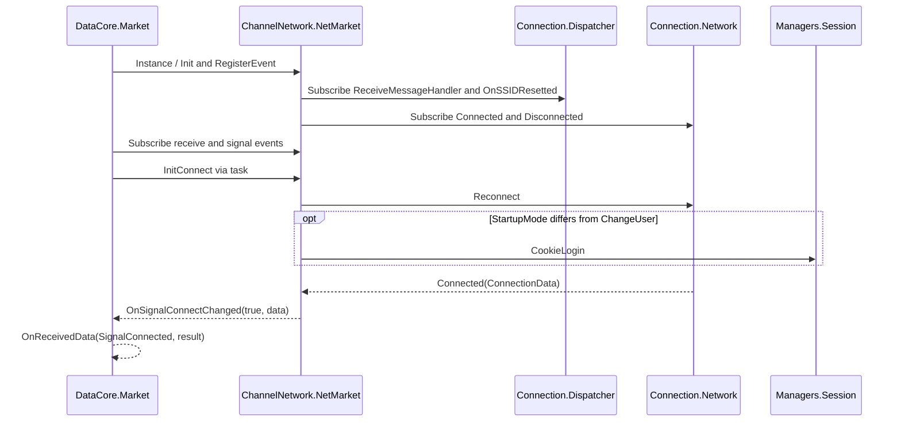

# Жизненный цикл сигнального соединения

Сетевое подключение и авторизация аккаунта управляются разными компонентами. В 1.5.9.3 QR-запрос использует тот же клиентский диспетчер, который работает до `SignedOn`.

## Инициализация

| Метод | Роль по IL |
| --- | --- |
| `Market.InitConnect()` | Подписывает `ReceiveMessageHandler`, `OnSignalConnectChanged`, `SSIDResetted` и диагностику. Через задачу вызывает `NetMarket.InitConnect`. |
| `NetMarket.Init()` | Инициализирует DNS-компонент и вызывает `InitNetServices`, затем переустанавливает подписки. `InitNetServices` сопоставляет действия с сервисами по атрибутам. |
| `NetMarket.InitConnect()` | Запускает `Network.Reconnect(bool, string, bool, bool, bool)`. Если режим отличается от `ChangeUser`, инициирует `Session.CookieLogin(string, bool)`. |
| `Network.Reconnect(…)` | Управляет запуском или повторным запуском подключения. По выбранной ветви использует `RunConnectThread(object)` или `ReconnectInner(bool, string, bool, bool, bool, bool)`. |
| `RunConnectThread(object)` | В ветви TCP создаёт `TcpClient`, получает `NetworkStream`, вызывает `HandleConnected` и запускает входящий и исходящий циклы. |
| `ReconnectInner(…)` | В ветви сложного соединения проверяет доступность сети и текущее подключение, формирует конфигурацию и вызывает `ComplexConnector.Connect` или `ConnectMultiple`. |
| `Network.HandleConnected(ConnectionData)` | Устанавливает `connectState=1`, сохраняет `connectedData`, устанавливает `User.State=1`, вызывает `OnConnected` напрямую или через очередь callback. |
| `NetMarket.Instance_Connected(object, EventArg<ConnectionData>)` | Поднимает `OnSignalConnectChanged(true, data)`. `Market.OnSignalConnectChanged` формирует `TaskResult` и публикует `SignalConnected`. |

Вызов `Session.CookieLogin` планирует запрос из уже созданного клиента. Успех сигнального соединения и факт входа проверяются по отдельным событиям. Смысл `SSID` в исследованном коде — состояние сетевого диспетчера. При сбросе диспетчера поступает `SSIDResetted`; его нельзя трактовать как доказательство входа или потери аккаунта.

## Потеря сети, reconnect и sign-off

- `Network.NetworkChange_NetworkAvailabilityChanged(object, NetworkAvailabilityEventArgs)` при потере сети вызывает `Disconnect()` и ставит `User.State=0`. При восстановлении доступности вызывает `Reconnect`.
- `HandleDisconnected()` ставит `connectState=0` и вызывает `OnDisconnected`. Через `NetMarket.Instance_Disconnected` событие доходит до `Market` как `SignalDisconnected`. Эта ветвь сама по себе не очищает сохранённый вход.
- `CheckConnectionInner()`, `ScheduleReconnect(bool, string)` и `ScheduleReconnectV2()` представляют дополнительные пути проверки и повторного соединения. Старый планировщик возвращается в `Reconnect`, а callback второй версии — в `ReconnectInner`. Набор ветвей зависит от настроек транспорта.
- `Market.OnSignalConnectChanged` передаёт `ResetDispatcher` и `IsSignOff` в модель `ConnectData`. `ChatsListViewModel.HandleResetConnected(TaskResult)` проверяет сброс, обновляет активный чат и при необходимости делает `SyncRecent` или синхронизацию группы. `SignInWithScanPageViewModel` отдельно обрабатывает сочетание сброса и sign-off.
- `AccountMessageManager.SignOff(string, bool)` завершает состояние аккаунта через отдельный callback. Этот маршрут описан в [машине состояний](session_state_machine.md).

## Наблюдение

В снимке живого процесса есть один установленный TCP-сеанс. Сетевой обрыв, изменение маршрута и повторный вход не инициировались. Снимок не определяет, какую из внутренних ветвей выбрал клиент. Имена методов, порядок подписок и ветви подтверждены IL. Наблюдение событий выполнения через CLR ETW требует доступной ETW-сессии. На этом хосте попытка запуска вернула `Access is denied`. [Снимок процесса](../research/lifecycle_traces/live-observation.json) · [Методы и ветви](../research/lifecycle_traces/isolated-il.txt) · [Документация CLR ETW](https://learn.microsoft.com/en-us/dotnet/framework/performance/clr-etw-providers)
