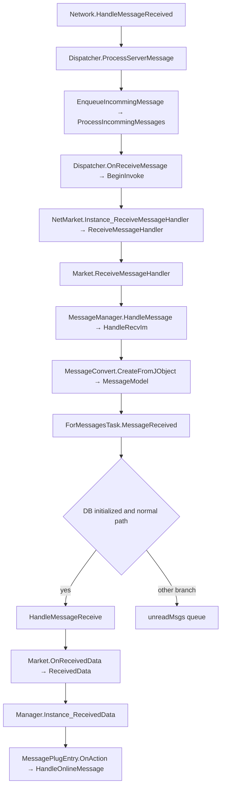

# Получение новых сообщений

## От транспорта к модели

Одна восстановленная цепочка для `recv_im` выглядит так:

1. `Network.HandleMessageReceived(string, string)` разбирает данные в `JObject` и передаёт их `Connection.Dispatcher.ProcessServerMessage(JObject, NameChannelSucDelegate, string)`. Для входящих push существует ветвь очереди `EnqueueIncommingMessage → ProcessIncommingMessages`. `Dispatcher.OnReceiveMessage(JObject)` вызывает делегат через `BeginInvoke`. У ответов на запросы есть иные ветви диспетчера.
2. `NetMarket.RegisterEvent()` подписывает `Instance_ReceiveMessageHandler(JObject)` на сетевой диспетчер. Этот обработчик вызывает `event Action<JObject> ReceiveMessageHandler`. Подписка `Market.ReceiveMessageHandler(JObject)` создаётся заранее в `Market.InitConnect()`.
3. `Market.ReceiveMessageHandler` достаёт вложенный `data`, преобразует его `type` в `DataType`, для `conv` вызывает `MessageManager.HandleMessage(JObject)`. Тот проверяет `name`. `recv_im` ведёт в `HandleRecvIm(JObject)`. `reflect` и `recv_unread_msgs` имеют отдельные обработчики.
4. `HandleRecvIm` передаёт вложенный объект в `MessageConvert.CreateFromJObject(JObject, MessageOrigin, MessageType, bool, bool)` и передаёт результат в `ForMessagesTask.MessageReceived(MessageModel, bool, bool)`. У `MessageReceived` есть ветвь очереди `unreadMsgs`, в том числе когда `DBMarket.DbHasInit` ещё false. Для обычной готовой ветви вызывается `HandleMessageReceive(MessageModel, bool)`.
5. `HandleMessageReceive` сначала разбирает специальные операции, в том числе удаление, замену и скрытие. Обычное сообщение помещается в `TaskResult.Data`. `Market.OnReceivedData(ActionTypes.MessageReceive, TaskResult)` вызывает `ReceivedDataHandler(ActionTypes, TaskResult)`. В этой ветви вызов события стоит перед обновлением контакта и операцией добавления в БД. Доступность callback и появление строки на диске могут расходиться по времени.
6. `Imo.Dispatcher.Manager.Instance_ReceivedData` вызывает `BasePlug.OnAction` для плагинов, затем своё `ReceivedData`. В `Imo.Message.MessagePlugEntry.OnAction` событие `MessageReceive` уходит в `ChatsListViewModel.HandleOnlineMessage(TaskResult)`. VM ставит обновление беседы на WPF-поток.

## Момент доступности

Оба внутренних делегата подписываются при запуске, до завершения входа. Это позволяет принимать аккаунтные уведомления и результаты QR. Наличие подписки не доказывает доступ к сообщениям аккаунта. Для обычной ветви сообщения важны серверный push, профиль текущего пользователя и готовность локальной БД. У `DevMessageManager` есть внутрипроцессные очереди диагностики. Они не являются каналом доставки для внешнего клиента.

## Эксперимент

В AppContainer созданы отдельные экземпляры `NetMarket` и `Market` для теста делегатов. Стенд вызвал реальный `NetMarket.Instance_ReceiveMessageHandler` с пустым синтетическим `JObject` и реальный `Market.OnReceivedData` с синтетическим `TaskResult`. Подписчик получил тот же объект `MessageModel`, который был помещён в результат. Между двумя вызовами стоял тестовый адаптер. Сетевой диспетчер, обработка `recv_im`, очередь и сохранение в БД в этом опыте не исполнялись. Их порядок проверен по IL.

Сквозного прогона с реальным входящим сообщением не было. Внешний наблюдатель видит состояние сокетов и загрузку модулей. Эти признаки не позволяют установить, что вызван конкретный делегат или получен новый текст. В проверенном профиле также отсутствовала таблица `T_Message`. [Трасса IL и результат теста](../research/lifecycle_traces/isolated-il.txt) · [Снимок SQLite](../research/evidence/snapshot.txt)
