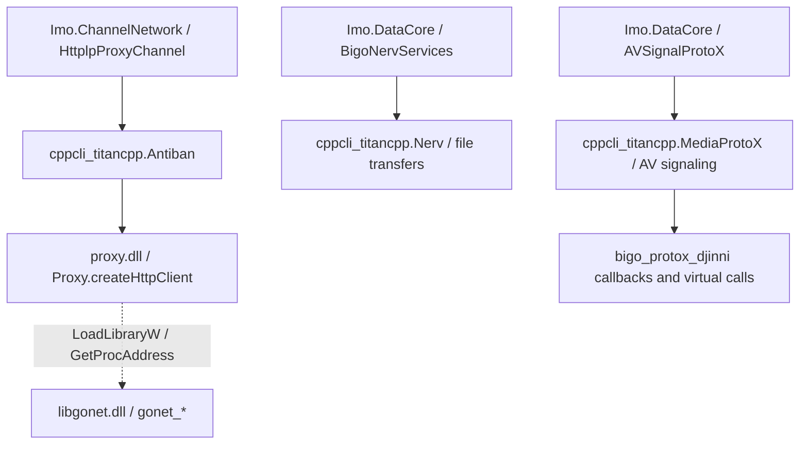

# Реверс libgonet.dll и libtitancpp.dll

Проверены файлы установленного IMO Windows 1.5.9.3. В отчёте адреса указаны как RVA относительно начала образа. PE и Go-метаданные разобраны Python, машинный код проверен Capstone и LLVM, смешанный C++/CLI-код — Mono.Cecil и ILSpy. Для проверки ABI использовался отдельный x86 AppContainer без capabilities.

| Файл | Что находится внутри | SHA-256 |
| --- | --- | --- |
| `libgonet.dll` | PE x86, Go 1.24.5, `c-shared`, cgo, без CLR и без COFF-символов. В проверенном экземпляре нет Authenticode-подписи. | `398B1324CDB04E61150550A8D164F5DBE485ADFD43FC46F4522C15CF328A39FE` |
| `libtitancpp.dll` | PE x86, смешанная сборка MSVC/C++/CLI с нативным кодом, MSVC RTTI и CLR fixups. Подпись Windows проверена. | `106A7EB2463D971F573634C9BA4B7F553958FEC0CF3BBC7855245E6D34AA84C7` |

[PE, хеши и адреса](../research/native_transport/native-evidence.json) · [Go build info](https://pkg.go.dev/debug/buildinfo) · [Смешанные сборки Microsoft](https://learn.microsoft.com/en-us/cpp/dotnet/mixed-native-and-managed-assemblies)

## Кто вызывает эти библиотеки



**Цепочка через `proxy.dll` доказана для HTTP-ветви.** В IL `HttplpProxyChannel.EnsureHttpClient()` вызывает `Antiban.CreateHttpClient(int, Dictionary<string,string>, string, int, int)`. `SendDataAndRecv(byte[])` вызывает `AntibanHttpClient.Send`. Внутри Titan `AntibanHttpClientImpl.{ctor}` вызывает `bp_proxy.Proxy.createHttpClient`. PE-импорты Titan из `proxy.dll` — `Proxy::createHttpClient` и `Proxy::init`, с переходниками RVA `0x5d9a05` и `0x5d9a0b`. В таблицах обычных и отложенных импортов Titan отсутствует прямая ссылка на `libgonet.dll`.

В `proxy.dll` xref на UTF-16-строку `libgonet.dll` ведёт к `LoadLibraryW` по RVA `0x153c43`. В том же коде `GetProcAddress` ищет `gonet_init` по `0x153cf8` и `gonet_new_tls` по `0x153f0c`. Для `gonet_conn_write` по `0x14c415` функция `GetProcAddress` загружается в EDI, по `0x14c432` вызывается через EDI, а возвращённый указатель сохраняется в `0x43998c`. Этот код условный. В снимке живого PID были загружены `libtitancpp.dll` и `proxy.dll`. `libgonet.dll` в тот момент отсутствовала в списке модулей. Это устанавливает состав модулей в момент измерения. Другие ветви, включая обычный `TcpClient` в `Imo.ChannelNetwork`, описаны отдельно. [Трасса вызовов](../research/native_transport/isolated-probe.txt) · [Соединение IMO](connection_lifecycle.md)

## libgonet.dll — граница C и Go

Из `pclntab` по RVA `0x6b6260` восстановлено **10 104 имени функций**. `go tool nm` сообщил `no symbols`, поскольку COFF-таблица отсутствует. PE экспортирует 18 рабочих `gonet_*` и один служебный `_cgo_dummy_export`. Для всех 18 найдены C-обёртка, адрес соответствующего `_cgoexp_*` и обычный `ret` без очистки стека, что соответствует x86 cdecl.

| Ветка | Восстановленный путь |
| --- | --- |
| Создание TCP/TLS, WebSocket и HTTP streaming | `gonet_new_tls/ws/hs → main.gonet_new_* → tlsSocket/wsClient/httpStreaming.Init → CHolder.Add`. У WebSocket найден вызов `gorilla/websocket.Dialer.DialContext`. У `newQuicConn` найден вызов `utls.UQUICClient`. Эти пути показывают возможности DLL. Активный транспорт конкретной сессии по ним определить нельзя. |
| Подключение и запись | `gonet_conn_connect/write → CHolder.Get → вызов через Go-интерфейс`. Для `conn_write` восстановлены три 32-битных входных позиции: дескриптор, указатель и длина. Из пары указатель/длина Go строит slice и вызывает реализацию записи. Ветка отсутствующего дескриптора возвращает `-2`. |
| События | `connCbWrapper.OnConnected/OnData/OnError/OnIdle` вызывают соответствующие C-обёртки callback. Для HTTP есть отдельные callbacks начала ответа, порции данных и завершения. |
| HTTP-клиент | `gonet_new_http()` добавляет объект в `CHolder`. `gonet_http_init` вызывает `httpClient.Init`; `gonet_http_send` находит объект и вызывает `httpClient.send`. Экспортированы также `http_cancel`, `http_info`, `http_close`. Полная раскладка сложных аргументов `http_init` и конструкторов транспорта здесь не восстановлена. |
| Освобождение | `gonet_destroy` вызывает `CHolder.Delete`. Отдельный `gonet_free` вызывает C `free`; это другая операция с другим типом ресурса. |

Упрощённая модель `gonet_conn_write` по дизассемблированию:

```text
entry = CHolder.Get(handle)
if entry is absent: return -2
return entry.Write(slice formed from data and length)
```

**Опыт в AppContainer.** Вызов `gonet_conn_write(0, NULL, 0)` вернул `-2`. `gonet_new_http()` дважды вернул ненулевой и различающийся локальный дескриптор. В намеренном отрицательном тесте `gonet_destroy()` вызывался до `gonet_http_init`. Обе обёртки вернулись, но Go дважды сообщил о перехваченной ошибке обращения к неинициализированному `sync.Cond` в `httpClient.Close`. Код выхода процесса был 0. Это подтверждает вызов ABI и отрицательный сценарий очистки. Штатный цикл инициализации и обмен HTTP-данными в эксперименте не проверялись. [Результат стенда](../research/native_transport/isolated-probe.txt)

## libtitancpp.dll — C++/CLI и ProtoX

В PE 21 экспорт MSVC, среди них конструкторы, деструкторы, vtables и константы `SettingKey`, а также `bigo_protox_djinni::YYProtoX::globalInitialize`. Его параметры по декорации включают `std::shared_ptr` для провайдера, логгера и статистики, плюс `bool`. Это C++ ABI MSVC. Управляемые публичные типы `cppcli_titancpp.*` находятся отдельно в CLR-метаданных. [Декорирование имён MSVC](https://learn.microsoft.com/en-us/cpp/build/reference/decorated-names?view=msvc-170)

- `BigoNervServices::.ctor` вызывает `Titancpp.Init(Logger, EnvironmentInfoProvider, ReportDelegate)` и `InitNerv(NervConfig)`. `UploadFile` и `DownloadFile` формируют `NervRequest`, создают `NervTask` и вызывают `Start`.
- `AVSignalProtoX.sendJSON` и `registerPush` вызывают `MediaProtoX.SendJSONWithParams` и `RegisterPush`. `startAndKeepConnectedIfUidNotEmpty` сначала проверяет предоставляемый клиентом UID, затем вызывает `StartAndKeepConnected`. Значение UID не считывалось.
- `MediaProtoXCppProxy` держит нативный объект через Djinni `ProxyCache` и `shared_ptr`. Его C++/CLI методы выполняют `calli` с `Thiscall` по слотам vtable. `MediaProtoXImpl.sendJSONWithParams` преобразует управляемые аргументы и вызывает следующий интерфейс `bigo_protox_djinni`.

Для `titancpp::MediaProtoXImpl` восстановлена цепочка RTTI `TypeDescriptor 0x8ee850 → CompleteObjectLocator 0x87cecc → vtable 0x8dd7c4`. В таблице слоты указывают на x86-переходники. Они читают ячейки CLR `VTableFixups`, где в файле лежат токены `MethodDef`. Токены сопоставлены с методами через Cecil.

| Слот | RVA переходника | MethodDef | Реализация |
| --- | --- | --- | --- |
| 1 | `0xbe904` | `0x060015c4` | `sendJSONWithParams` |
| 2 | `0xbc8da` | `0x060015c6` | `cancelJSONRequest` |
| 3 | `0xbe9e0` | `0x060015c7` | `registerPush` |
| 4 | `0xbc905` | `0x060015c8` | `startAndKeepConnected` |
| 5 | `0xbc931` | `0x060015c9` | `disconnect` |
| 6 | `0xbc95f` | `0x060015ca` | `getState` |
| 7 | `0xbeaa0` | `0x060015cb` | `addStateListener` |

[RTTI и fixups](../research/native_transport/native-evidence.json) · [CLR-сигнатуры и токены](../research/native_transport/titan-interop.txt)

## Граница интеграции

Экспорты `libgonet` работают с локальными дескрипторами транспорта. Интерфейс `MediaProtoX` работает с объектами и callbacks, переданными кодом IMO в том же процессе. В разобранных экспортах и обёртках не найдено точки присоединения к авторизованной сессии другого процесса. Протокольные кадры, ключи, содержимое сессии и реальный сетевой обмен в стенде не исследовались.

[Скрипты и воспроизведение](../research/native_transport/README.md)
