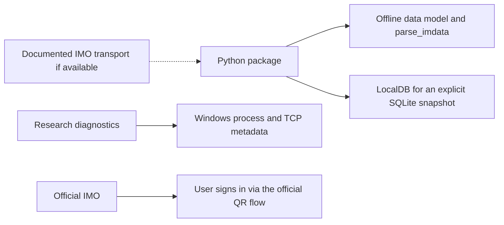

# Архитектура imo-python без UI Automation

Рабочий Python-клиент для авторизованной сессии потребовал бы интерфейса, который доступен из другого процесса и переносит команды, состояние и события аккаунта. В IMO Windows 1.5.9.3 такой интерфейс среди проверенных поверхностей не найден. Известный локальный TCP/Remoting-порт используется для активации окна. Загрузка DLL в отдельном x86-процессе создаёт собственные объекты и собственные подписки. `NetMarket.InitConnect` запускает подключение этого процесса.

## Контракты и границы

| Желаемая операция | Что подтверждено сейчас | Что нужно для реализации |
| --- | --- | --- |
| `IMOClient(session="main").connect()` | Можно обнаружить запущенный официальный процесс. Поле с именем сессии Python не имеет соответствия с внешним интерфейсом IMO. | Официальный канал подключения к клиенту или поддерживаемая авторизация SDK. |
| `is_connected` | Можно прочитать число TCP-соединений процесса. CLR отдельно ведёт транспорт, авторизацию и состояние QR. | Документированный внешний сигнал состояния. Пока диагностика может честно сообщить `process_running` и `tcp_established`. |
| `get_me()` | Внутренний профиль читают `IMO.Instance.User` и `GetMyProfile`. | Контракт на чтение профиля уже авторизованного аккаунта. |
| `on_login_required` | Штатный Windows-клиент открывает свою страницу входа и поддерживает сканирование телефоном. | Внешний сигнал о необходимости входа для надёжного callback. Открытие официального клиента можно рассматривать отдельно от определения авторизации. |
| `on_message` и `run()` | События CLR локальны процессу. SQLite-кэш в проверенном профиле не содержит сообщений. | Поддерживаемая подписка или экспорт, из которого документированно можно выделять новые сообщения. |
| Отправка | Найдена внутренняя цепочка `Market.RunTask → ForMessagesTask → NetMarket.Work`. | Поддерживаемый канал отправки с обработкой статуса и ошибок. |

## Реалистичное разделение

1. Сохранить работоспособный офлайн-слой `imo.models`, `parse_imdata` и `imo.localdb.LocalDB`. Копию базы передаёт пользователь. Пустой кэш означает отсутствие доступных локальных записей.
2. Держать Windows-диагностику отдельной от SDK. Снимок процесса полезен для исследования, но его поля не следует выдавать за состояние аккаунта.
3. Выделить интерфейс провайдера, когда появится документированный канал с доказанной авторизацией, чтением профиля и доставкой событий. Перед выпуском проверить полный цикл на отдельном тестовом аккаунте. До такой проверки пример `IMOClient` остаётся эскизом контракта.

Штатные плагины вызываются внутри IMO. Встраивание собственного плагина потребовало бы выполнения кода в официальном клиенте. Отдельный клиент через закрытый протокол потребовал бы самостоятельного управления сетевой сессией. Эти пути выходят за установленные границы проекта.

[Предыдущая проверка IPC и bridge](integration-report.md) · [Состояния входа](session_state_machine.md) · [Справка IMO о способах входа](https://imo.im/faq/More-Ways-to-Login)
