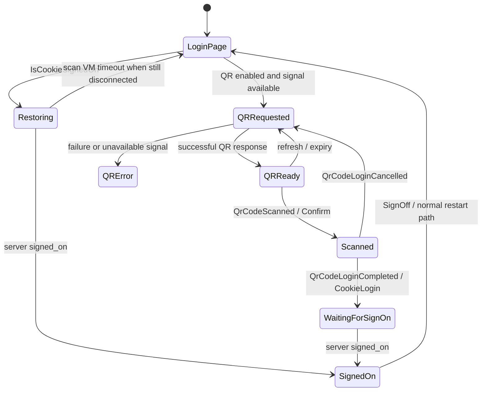

# Машина состояний входа и сессии

В IMO Windows 1.5.9.3 состояние входа распределено между несколькими объектами. Имена на диаграммах описывают проверенные комбинации этих полей и событий.

| Слой | Реальное состояние |
| --- | --- |
| Сигнальное соединение | `Imo.ChannelNetwork.Connection.Network.connectState` — `int`. `HandleConnected` записывает 1, `HandleDisconnected` записывает 0. `User.State` тоже `int`: `HandleConnected` выставляет 1, обработчик недоступности сети выставляет 0. QR-страница проверяет `User.State == 1` как признак доступности транспорта. |
| Сохранённая авторизация | `ApplicationSettings.IsCookieSignedOn` — признак в настройках. `true` означает наличие сведений о предыдущем входе. Сервер может их отклонить. |
| Авторизация в процессе | `ApplicationProperties.IsSignedOn` выставляется в ветви `signed_on`, очищается в отложенном `AccountMessageManager.SignOff`. `CookieSignOnFailed` — отдельный флаг. |
| Временный экран QR | `QRCodeStatus.Error=0`, `Request=1`, `Success=2`, `Invalid=3`, `Confirm=4`, `NetworkError=5`. `Success` относится к получению изображения QR. `Confirm` устанавливается после сканирования. VM также ведёт флаги `isRequest`, `ShowBeginScanCode` и `ShowBusyIndicator`. |
| Режим запуска | `EnumStartupMode.Normal=0`, `ChangeUser=1`, `ForcePCOff=2`, `Exit=3`, `Restart=4`. `NetMarket.InitConnect` пропускает стартовый `Session.CookieLogin` при `ChangeUser`. |

`LoginPage`, `Restoring` и `WaitingForSignOn` — описательные состояния, отдельного enum с такими значениями в исследованных сборках нет. События завершения и отмены обрабатываются по имени без жёсткой проверки предшествующего состояния `Confirm`. Транспорт может подключиться до входа и временно пропасть после входа. `SignalConnected` и `SignedOn` приходят по разным путям.

## Точка авторизации

В `AccountMessageManager.<HandleMessage>d__7.MoveNext` ветвь `signed_on`:

1. Вызывает `SetCurrentUserUid(string)` и сохраняет результат как `isInitialSignOn`.
2. Обновляет `CookieUid` и `IsCookieSignedOn`, вызывает `UserStorage.Init(string)` и `User.UpdateFromSignedOnData(JObject)`.
3. На первоначальном входе вызывает `DBMarket.Execute(DBActionTypes.InitDB, ...)`; часть сервисов активируется условно, например по флагу AV.
4. Выставляет `ApplicationProperties.IsSignedOn=true`, сбрасывает `CookieSignOnFailed`. После ветвей настройки и `Task.Delay(500)` публикует `OnReceivedData(ActionTypes.SignedOn, TaskResult)`. В `TaskResult.Data` лежит `SignOnData(JObject, bool)`.

`cookie_login_failed` устанавливает `CookieSignOnFailed`, если ранее был сохранён признак входа. Этот фрагмент сам по себе не вызывает `ClearCookieData`. В QR-VM таймер 25 секунд относится к ожиданию подключения при сохранённом входе. Его callback делает `Reset`, если `IsCookieSignedOn` всё ещё установлен и `isConnected` остаётся false. Условие таймера не следует читать как универсальный 25-секундный тайм-аут авторизации.

## Восстановление и завершение

`ApplicationSettings.InitFromStorage` читает общие настройки через `ApplicationStorage.GetSettings`. По коду `ApplicationStorage` хранит прикладные настройки в файле `data` под каталогом `data` или `data1` приложения. `UserStorage.Init` открывает отдельный файл `data` в пользовательском подкаталоге, а история и список чатов имеют отдельный SQLite-слой `DB/db1.db`. Названия и роли установлены по коду. Содержимое хранилища авторизации не открывалось.

При обычном повторном запуске `Session.CookieLogin` использует текущий клиентский диспетчер. При успешном ответе сервер снова присылает `signed_on`. QR-страница может создаваться и в этом сценарии, но её создание не означает, что пользователю придётся снова сканировать код.

Один подтверждённый маршрут серверного завершения — `signoff_all → AccountMessageManager.SignOff(string, true)`. Отложенный callback вызывает `User.Clear`, `UserSettings.Clear` и `ApplicationSettings.ClearCookieData`, выставляет `IsSignedOn=false` и публикует `SignOff`. `MainEntry.OnAction` может запустить `AppHelper.ReStart(ChangeUser)` по флагу результата. Справка IMO подтверждает возможность удаления привязанного устройства. Соответствие действия удаления на телефоне именно событию `signoff_all` в 1.5.9.3 не наблюдалось. [Управление устройствами в IMO](https://imo.im/en/faq/How-to-Manage-Devices)

[Метаданные состояний](../research/assembly_map/installed.json) · [IL переходов](../research/lifecycle_traces/isolated-il.txt)
